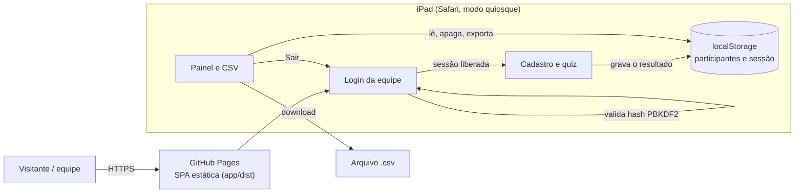

# 05 Arquitetura da solução

> Escrito para: desenvolvimento e InfoSec. Estado: rascunho, aguarda G3 e G4.

## Decisão: uma SPA sem back end

Não há Front e Back separados. A solução é um site estático (SPA) que roda no navegador do iPad. Os dados ficam no `localStorage` do aparelho, e o site é publicado no GitHub Pages. Não há servidor, banco de dados nem serviço em nuvem.

## Diagrama

## Componentes

Mantém as camadas atuais (`domain`, `application`, `infrastructure`, `features`, `composition`, `content`, `kernel`):

| Componente | Camada | Papel |
|------------|--------|-------|
| `domain/access-lock.js` | domain | Regras puras do bloqueio (5 erros, 30 segundos) e busca de conta por e-mail |
| `application/create-access-control.js` | application | Caso de uso do login: valida, registra o erro, cria e encerra a sessão |
| `infrastructure/password-hash.js` | infrastructure | PBKDF2-SHA256 via WebCrypto, com comparação em tempo constante |
| `infrastructure/local-access-store.js` | infrastructure | Sessão e contador de erros no `localStorage` |
| `infrastructure/local-storage-participant-repository.js` | infrastructure | Participantes no `localStorage` (como antes) |
| `content/staff-accounts.js` | content | Lista de contas: e-mail, rótulo, salt, iterações e hash. Nunca a senha |
| `features/login/` | features | Tela de login, a primeira quando não há sessão |
| `features/staff/` | features | Painel, lista, CSV, apagar tudo e "Sair" |
| `scripts/staff-account.mjs` | scripts | Gera uma entrada de conta a partir de uma senha lida do stdin |

As regras de dependência continuam valendo: `features` só importa `kernel` e a própria pasta. Os testes de arquitetura (`guardrails.test.js`) verificam isso.

## Modelo de dados

Chave `tw-platform-quiz:v1:participants` (JSON, um array). Cada item é um resultado:

| Campo | Tipo | Observação |
|-------|------|------------|
| `id`, `createdAt` | string | Gerados no aparelho |
| `name`, `company`, `role` | string (até 120) | Obrigatórios |
| `email` | string (até 254) | Dado pessoal. Nunca exibido no painel |
| `phone` | string (até 32) | Dado pessoal. Nunca exibido no painel |
| `score`, `accuracyPct` | number | Pontuação e precisão |
| `newsletterOptIn`, `consentShare` | boolean | `consentShare` é `true` |
| `language` | `pt` ou `en` | |

Chave `tw-platform-quiz:v1:session`: `{ "label": "Equipe 1" }` quando a equipe está logada. Chave `tw-platform-quiz:v1:access-lockout`: contador de erros e fim do bloqueio.

## Fluxos

**Abrir o site**
1. Sem sessão válida (`label` que existe em `STAFF_ACCOUNTS`), a primeira tela é o login.
2. Com sessão, a primeira tela é o cadastro.

**Login**
1. Se há bloqueio ativo, a resposta é "bloqueado", com os segundos restantes.
2. Procura a conta pelo e-mail (sem diferenciar maiúsculas e espaços).
3. Calcula o PBKDF2 da senha com o salt da conta e compara com o hash.
4. Acerto: zera os erros, grava a sessão e abre o cadastro. Erro: soma um erro, e no quinto bloqueia por 30 segundos.

**Jogar**
1. Cadastro, perguntas, resultado. Nenhuma tela de login.
2. "Próximo participante" volta ao cadastro, com a sessão mantida.

**Painel e CSV**
1. Long-press de 1,5 s no logo abre o painel, só com sessão.
2. A lista e o CSV vêm de `localStorage`, na mesma ordem e formato de hoje.
3. "Sair" apaga a sessão e volta ao login. Nenhum timer de inatividade.

## Segurança e limites (registrados para a InfoSec)

- O login é uma barreira de **uso casual**. O site é público, então quem lê o código tem os hashes e pode testar senhas offline. Quem edita o `localStorage` pode forçar a sessão. Só um servidor resolveria isso, e está fora do escopo (Q2).
- Por isso as senhas precisam ser longas (12 caracteres ou mais) e as iterações do PBKDF2 ficam em 600 mil.
- Os e-mails das contas ficam visíveis no bundle público (Q5).
- A CSP continua estrita: `connect-src 'self'`, sem script remoto.

## Placar (U4, em revisão)

Sem armazenamento novo: o placar lê os resultados que já existem e mostra só uma projeção.

| Componente | Camada | Papel |
|------------|--------|-------|
| `domain/leaderboard.js` | domain | Função pura: recebe os participantes e devolve `[{ rank, displayName, score }]`. Aplica a regra de nome (Q19), a ordem e o desempate (FR-18), e exclui testes e duplicados (Q20). Não importa pacotes nem DOM |
| `application/create-quiz-app.js` | application | Novo caso de uso `leaderboard()`: lê os participantes pela porta de repositório existente e devolve só a projeção |
| `features/leaderboard/` | features | Tela do placar. Recebe `ctx` e `props`, sem acessar o repositório diretamente |
| `composition/screens.js` | composition | Registro do novo item no registro lazy, com a condição de exibição definida por Q17 |
| `content/messages.*.js` | content | Rótulos PT e EN |

**Regra de isolamento:** a projeção é o único dado que a tela recebe. E-mail e telefone nunca entram no objeto da tela, então não há como exibi-los por engano. O teste de domínio verifica isso.

**Fonte dos dados (Q18, decidida: opção B):**
- A equipe importa os dois CSV no painel. O app lê, valida o cabeçalho (`Nome`, `Email`, `Pontuacao`, `Data_Hora`) e mescla com os resultados deste iPad. Linhas inválidas são contadas e descartadas.
- A mescla (equipe fora, duplicados pela maior pontuação) é uma função pura em `domain/leaderboard.js`, testada com dados fictícios.
- Pendente (Q18b): guardar o placar importado no `localStorage` ou só em memória.
- Os valores vindos de CSV são texto. Nunca vão para `innerHTML`, e a leitura trata fórmulas (`=`, `+`, `-`, `@`) como texto.
- Descartada: lista fixa no código, gerada a partir de planilhas. Publicaria nomes de participantes no site público, contra a regra 5 do `CLAUDE.md` e contra a aprovação de Q1.

## Orçamento e desempenho

- A entrada do bundle inclui o login (pequeno) e continua dentro de 40 kB gzip.
- A verificação de senha usa WebCrypto nativo. Não há biblioteca nova.

## Falhas e como o sistema responde

| Situação | Comportamento |
|----------|---------------|
| Senha errada | Mensagem genérica, campo limpo, erro contado |
| Quinto erro seguido | Bloqueio de 30 segundos, com contagem na mensagem |
| Nenhuma conta configurada | Login sempre falha. O quiz não abre |
| Recarregar com sessão | Continua logado |
| Dados corrompidos no `localStorage` | Quarentena, como antes (`repository.test.js`) |
| Falha ao salvar um resultado | Aviso para o participante procurar a equipe |
| Apagar tudo | Dois toques. Só este iPad é afetado |
