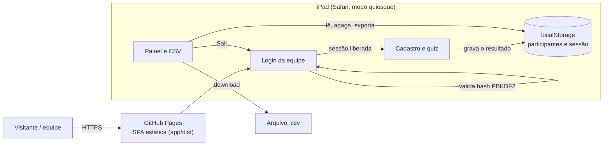

# Quiz de engenharia de plataforma e AI da Thoughtworks

Quiz bilíngue (PT/EN) para o estande da Thoughtworks em eventos de tecnologia. A equipe entra com o login, e o participante responde perguntas cronometradas (5 básicas e 2 avançadas) e recebe a pontuação. A equipe baixa os cadastros em CSV para o sorteio.

> **Escopo atual:** site estático (SPA) com dados só no `localStorage` do iPad. Não há servidor, nuvem nem Firebase. A especificação está em [.claude/aidlc-docs/](.claude/aidlc-docs/README.md).

## Arquitetura da solução

A solução é uma SPA estática. O site é publicado no GitHub Pages, e tudo o que acontece depois roda no navegador do iPad.

### Fluxo

1. **Equipe:** abre o site e entra com o e-mail e a senha da conta. O login fica liberado no iPad até a equipe tocar em "Sair".
2. **Participante:** preenche o cadastro e joga. Não há tela de login entre as rodadas.
3. **Equipe:** dá long-press no logo para abrir o painel, vê a lista e baixa o CSV, que sai dos dados do `localStorage`.

### Divisão de pastas

| Pasta | Conteúdo |
|-------|----------|
| `app/` | SPA em Vite e JavaScript puro (quiz, login, painel) |
| `.claude/aidlc-docs/` | Especificação: intenção, requisitos, histórias, unidades, arquitetura, perguntas abertas |
| `.claude/` | Apoio ao desenvolvimento: skills de marca, InfoSec, quiz e definição de pronto |
| `.github/workflows/` | Entrega: `ci.yml` (pull request, `verify`) e `pages.yml` (deploy no `main`) |

## Documentação

- [.claude/aidlc-docs/README.md](.claude/aidlc-docs/README.md): especificação completa e portões de aprovação.
- [.claude/aidlc-docs/inception/06-open-questions.md](.claude/aidlc-docs/inception/06-open-questions.md): decisões pendentes, incluindo a aprovação da InfoSec para publicar o site público.
- [app/README.md](app/README.md): como executar, testar, cadastrar contas e usar o quiz no estande.
- [CLAUDE.md](CLAUDE.md): contexto para o assistente de IA e regras de engenharia.

> Este código foi gerado por IA. Requer revisão manual por pessoas e varredura SAST/DAST antes da implantação.
